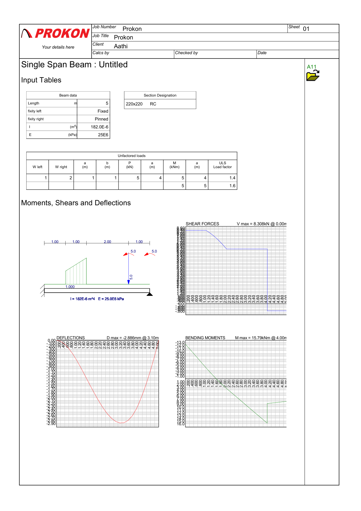

# Single-Span Beam Analysis (Prokon A11)

Analysis of a 5 m reinforced-concrete beam, fixed at one end and pinned at the other, using the Prokon **A11 single-span beam** module. The results are carried into the section design in [beam section](../beam%20section).

**Status:** ✅ Complete.

## Input

| Item | Value |
|---|---|
| Span | 5.0 m |
| Supports | Fixed (left), pinned (right) |
| Section | 220 × 220 mm RC |
| Stiffness | I = 182 × 10⁻⁶ m⁴, E = 25 GPa |
| Loads | Linearly varying distributed load from 1 to 2 kN/m (1–2 m), 5 kN point load at 4 m, 5 kN·m applied moments at 4 m and 5 m |
| ULS load factors | 1.4 and 1.6 (per load row) |

## Results

| Result | Value |
|---|---|
| Maximum bending moment | **15.79 kN·m** at 4.0 m |
| Maximum shear force | **8.31 kN** at 0.0 m (fixed support) |
| Maximum deflection | **2.89 mm** at 3.1 m (≈ span/1730) |

## Files

| File | Description |
|---|---|
| `Simple span beam.A11` | Prokon A11 input file |
| [Output.pdf](Output.pdf) | Prokon output sheet: input tables, shear force, bending moment and deflection diagrams |
| `images/a11-beam-analysis.png` | PNG render of the output sheet |

Open the `.A11` file in Prokon's single-span beam module.
