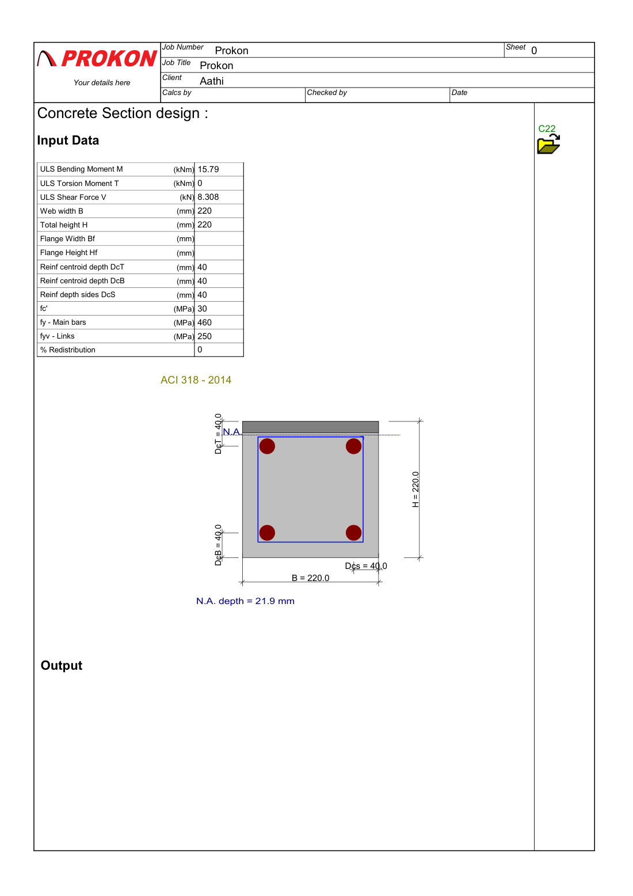

# RC Beam Section Design (Prokon C22, ACI 318-14)

Flexure, shear and torsion design of a 220 × 220 mm reinforced-concrete beam section using the Prokon **C22 concrete section design** module. The design actions come from the [single-span beam analysis](../Simple%20span%20beam).

**Status:** ✅ Complete.

## Input

| Item | Value |
|---|---|
| Design actions | Mu = 15.79 kN·m · Vu = 8.308 kN · Tu = 0 |
| Section | 220 mm wide × 220 mm deep, 40 mm to the reinforcement centroid |
| Concrete | f′c = 30 MPa |
| Steel | fy = 460 MPa (main bars), fyv = 250 MPa (links) |
| Design code | ACI 318-14 |

## Results

| Result | Value |
|---|---|
| Neutral axis depth | 21.9 mm |
| Moment capacity Muc | 59.1 kN·m |
| Required tension steel As | 223 mm² (minimum 121 mm²) |
| Compression steel | Not required |
| Suggested bars | 5Y8 (251 mm²), 3Y10 (236 mm²) or 2Y12 (226 mm²) |
| Concrete shear capacity Vc | 26.30 kN > 8.31 kN, so nominal links only (e.g. 2 legs Y8 @ 300 mm) |
| Torsion threshold Tc | 10.98 kN·m (no torsion applied) |

## Files

| File | Description |
|---|---|
| `beam section.C22` | Prokon C22 input file |
| [output.pdf](output.pdf) | 8-page output with design results and detailed ACI 318 calculations |
| `images/c22-section-design.png` | PNG render of page 1 |

Open the `.C22` file in Prokon's concrete section design module.
